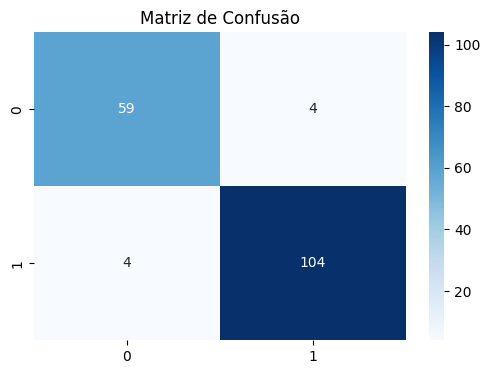
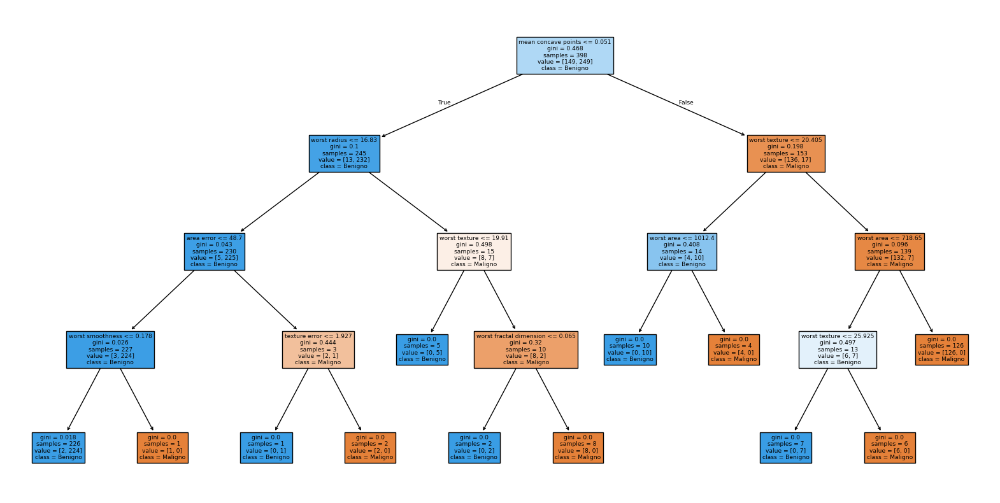

# Classificação de Tumores Mamários com Árvore de Decisão

Projeto de Machine Learning que classifica tumores mamários como **malignos** ou **benignos** a partir de características extraídas de exames, usando o algoritmo **Árvore de Decisão** (scikit-learn).

> Trabalho acadêmico da disciplina *Analytics com Python* (FUMEC). O foco é aplicar o fluxo completo de um projeto de classificação: exploração dos dados, treino, avaliação e interpretação.

## Dados

- **Fonte:** *Breast Cancer Wisconsin Dataset*, disponível no scikit-learn (`load_breast_cancer`)
- **Tamanho:** 569 amostras e 30 variáveis numéricas (raio, textura, área, concavidade etc.)
- **Variável alvo:** `0` = maligno, `1` = benigno (212 malignos e 357 benignos)

## Metodologia

1. Carregamento e conhecimento do dataset (`shape`, `info`, `describe`)
2. Análise exploratória: distribuição das classes, histograma do raio médio e mapa de correlação
3. Separação em treino (70%) e teste (30%), com `random_state=42`
4. Treino de uma `DecisionTreeClassifier` com `max_depth=4`
5. Avaliação com matriz de confusão e relatório de classificação

## Resultados

Desempenho no conjunto de teste (171 amostras):

| Classe | Precisão | Recall | F1-score | Amostras |
|---|---|---|---|---|
| Maligno (0) | 0,94 | 0,94 | 0,94 | 63 |
| Benigno (1) | 0,96 | 0,96 | 0,96 | 108 |
| **Acurácia geral** | | | **0,95** | 171 |



Dos 63 tumores malignos do teste, 59 foram identificados corretamente e **4 foram classificados como benignos**. Em um contexto de diagnóstico, esse é o erro mais grave (falso negativo), por isso o recall da classe maligna é a métrica mais importante a acompanhar.

### Árvore gerada

A árvore de profundidade 4 permite ler as regras de decisão do modelo, uma vantagem de interpretabilidade em relação a modelos mais complexos.



## Como executar

```bash
git clone https://github.com/GustavoCosta10/classificacao-tumores-arvore-decisao.git
cd classificacao-tumores-arvore-decisao
pip install -r requirements.txt
jupyter notebook notebooks/classificacao-tumores-arvore-decisao.ipynb
```

O dataset já vem com o scikit-learn, então não é preciso baixar nenhum arquivo.

## Limitações e próximos passos

- [ ] Comparar com outros modelos (Regressão Logística, Random Forest, SVM, XGBoost)
- [ ] Usar validação cruzada em vez de uma única divisão treino/teste
- [ ] Ajustar hiperparâmetros (por exemplo, `max_depth`) com `GridSearchCV`
- [ ] Analisar a importância das variáveis
- [ ] Priorizar o recall da classe maligna na escolha do modelo, já que falsos negativos são mais custosos

## Tecnologias

Python · pandas · NumPy · scikit-learn · matplotlib · seaborn

## Autor

**Gustavo Costa Nascimento** · [LinkedIn](https://www.linkedin.com/in/gustavo-costa-nascimento/) · [GitHub](https://github.com/GustavoCosta10)
